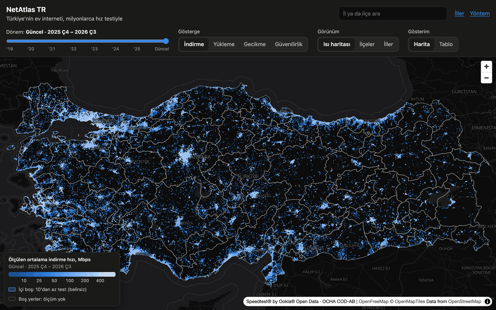
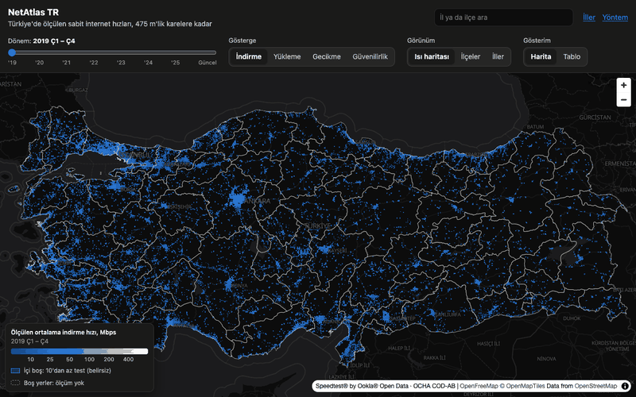
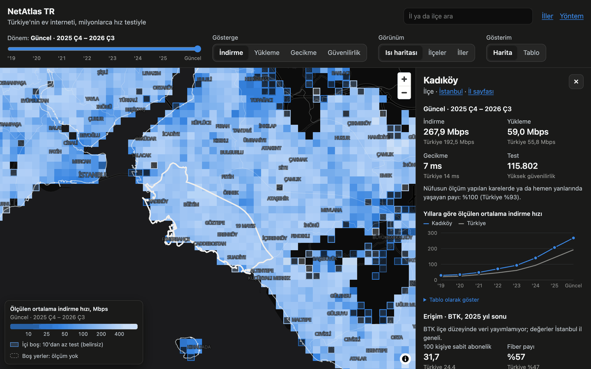
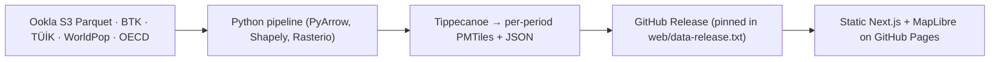
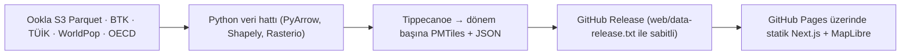

# NetAtlas TR

**An interactive map of home internet speeds across Türkiye,** built from Ookla's Speedtest data since 2019.

[Türkçe](#türkçe)

> **Site:** https://mertkara256.github.io/netatlas-tr/ · Built step by step following the [roadmap](docs/YOL-HARITASI.md) (in Turkish).

[](https://mertkara256.github.io/netatlas-tr/)

## At a glance

- Türkiye's average measured home download speed rose from **20.9 Mbps in 2019 to 143.0 Mbps in 2025**, almost seven times as fast. Upload went from 5.2 to 45.4 Mbps, latency from 26 to 14 ms.
- In 2025 alone: 5.0 million Speedtest results, on about 99,000 squares of 475 m.
- 93% of residents live in or next to a square where someone ran a test.



## What it shows

- Average download, upload and latency from Ookla's open Speedtest data as a heat map: Ookla's own ~475 m squares (at Türkiye's latitude) up close, merged into larger cells as you zoom out, plus province and district summaries.
- How reliable each value is, based on the number of tests behind it.
- Yearly views from 2019 to 2025, a "current" view of the latest four published quarters, and a side-by-side divider to compare any two periods.
- A "1 km around you" lookup read directly from the map's tiles, and a breakdown of province and national speeds into three settlement types (`yoğun kent`, `orta yoğun kent`, `kır`).
- Fixed-broadband subscriptions per 100 people and per 100 households and fiber share per province, from BTK (Türkiye's telecom regulator), with households from TÜİK's average household size, plus a [fiber page](https://mertkara256.github.io/netatlas-tr/fiber/) showing where fiber has passed xDSL, Türkiye against the 12th Development Plan's 2028 target, and Türkiye among the 38 OECD members.
- The share of each province's and district's residents who live in or next to a square where a test was run.



It shows what people actually measured in an area, not the maximum speed available at a specific address. How the values are computed, what to keep in mind and all sources are on the [methodology page](https://mertkara256.github.io/netatlas-tr/yontem/) (in Turkish).

## How it's built

The site is a static Next.js export on GitHub Pages with no server or database. Geospatial processing runs offline in Python, and the browser reads vector tiles directly over HTTP Range requests.



Key design decisions (full notes and experiments in [docs/YOL-HARITASI.md](docs/YOL-HARITASI.md)):

- **Row-group pruning on Ookla's S3 Parquet files:** Reads only the quadkey row groups that intersect Türkiye (10–35 MB for most quarters instead of the full global files), writing local caches atomically after checking the Parquet footer and schema ([`pipeline/ookla.py`](pipeline/ookla.py)).
- **Per-period PMTiles:** Splitting cells into one PMTiles archive per period cut the map's opening transfer from 2.1 MB to 0.5 MB (~0.2 MB when switching periods), while keeping the tiles and JSON out of git in GitHub Releases ([`pipeline/tiles.py`](pipeline/tiles.py)).
- **Browser-side spatial queries without a backend:** The 1 km lookup decodes zoom-12 vector tiles directly from the shared LRU tile cache ([`web/lib/nearby.ts`](web/lib/nearby.ts), [`web/lib/siteTiles.ts`](web/lib/siteTiles.ts)), counting each square only in the tile holding its center so tippecanoe's tile buffers are never double-counted.
- **Empirically checked methodology:** Device-weighted averages (verified with split-half volatility checks), reliability floors (10 and 200 tests), WorldPop vs. GHSL validation against TÜİK provincial totals, Eurostat-style settlement clustering ([`pipeline/settlement.py`](pipeline/settlement.py)), and OKLab-spaced, color-blind-checked ramps ([`web/lib/colors.ts`](web/lib/colors.ts)).
- **Automated quarterly updates:** A weekly GitHub Action checks Ookla's S3 bucket for new quarters, builds `tippecanoe` pinned to a commit SHA, runs the full pipeline and test suite, publishes a Release, redraws the OpenGraph preview, and opens a pull request ([`.github/workflows/data-update.yml`](.github/workflows/data-update.yml)).
- **Cross-layer tests:** Python pipeline tests (including hand-verified coastal and border fixtures that run in CI without raw data), frontend unit/agreement tests covering tile caching, URL hash state, request races, and Python–TypeScript agreement on Turkish name folding and reliability labels ([`web/tests/pipeline-agreement.test.mjs`](web/tests/pipeline-agreement.test.mjs)), and Playwright browser smoke tests over the built static site ([`web/e2e/smoke.spec.ts`](web/e2e/smoke.spec.ts)).

## Data files

- [`data/processed/`](data/processed) has the tables behind the site as CSV: speeds per province (`iller_hiz.csv`) and district (`ilceler_hiz.csv`) for every period, per province and settlement type (`iller_yerlesim.csv`: yoğun kent, orta yoğun kent, kır), BTK's statistics per province and year (`btk_iller.csv`), the list of districts (`ilceler.csv`), fixed-broadband subscriptions per 100 inhabitants and fiber's share in the 38 OECD members (`oecd_genisbant.csv`, from the OECD's broadband database, for the fiber page), and TÜİK's average household size per province and year (`tuik_hane.csv`, for subscriptions per 100 households).
- [Releases](https://github.com/mertkara256/netatlas-tr/releases) hold the files the site loads: the map tiles (PMTiles) and the province, district and search JSON. `web/data-release.txt` names the release the site uses.

## Running locally

Needs [GitHub CLI](https://cli.github.com/) (signed in), Node.js 22 and [uv](https://docs.astral.sh/uv/). From the repository's root:

```bash
gh release download "$(cat web/data-release.txt)" --dir web/public/data
cd web && npm ci && npm run dev
```

The site is then at http://localhost:3000/. Run the linters and test suites from the root (pipeline tests that need raw downloads are skipped without them; frontend agreement tests check against `web/public/data/`):

```bash
uv run --locked ruff check
uv run --locked pytest
cd web && npm run lint && npm test
```

To run the Playwright smoke tests against the static build (`npx playwright install chromium` once beforehand):

```bash
cd web && npm run build && npm run test:e2e
```

### Refreshing manual data tables

- `oecd_genisbant.csv` is not part of the weekly data update; refresh it by hand with `uv run --locked python -m pipeline.oecd`, which takes the last quarter of the latest full year.
- `tuik_hane.csv` is not part of the weekly data update either. TÜİK's server refuses downloads outside a browser, so save the table "İllere Göre Ortalama Hanehalkı Büyüklüğü" from [TÜİK's ADNKS bulletin](https://veriportali.tuik.gov.tr/tr/press/53899) as `data/raw/tuik/ortalama_hane_buyuklugu_2008_2025.xls`, then run `uv run --locked python -m pipeline.tuik`.

## Data sources

| Data | Source | License |
|---|---|---|
| Fixed-broadband speed tests | [Speedtest® by Ookla® Open Data](https://github.com/teamookla/ookla-open-data) | CC BY-NC-SA 4.0 |
| Provincial subscriptions and fiber | [BTK, Yıllık İl İstatistikleri](https://www.btk.gov.tr/yillik-il-istatistikleri) | No open license (© BTK); used with attribution |
| Average household size per province | [TÜİK, Adrese Dayalı Nüfus Kayıt Sistemi Sonuçları](https://veriportali.tuik.gov.tr/tr/press/53899) | Reuse with attribution ([TÜİK legal notice](https://www.tuik.gov.tr/Kurumsal/Yasal_Uyari)) |
| Fixed broadband in OECD countries | [OECD, Broadband and telecom databases](https://data-explorer.oecd.org/vis?df[ds]=dsDisseminateFinalDMZ&df[id]=DSD_BB_DATABASE%40DF_BB_TEL_DATABASE&df[ag]=OECD.STI.DEP) | Reuse with attribution ([OECD terms](https://www.oecd.org/en/about/terms-conditions.html)) |
| Where people live | [WorldPop, gridded population estimates for Turkey 2021](https://doi.org/10.5258/SOTON/WP00758), spreading TÜİK's district populations | CC BY 4.0 |
| Province and district boundaries | [OCHA COD-AB Türkiye](https://data.humdata.org/dataset/cod-ab-tur), from the General Command of Mapping (Harita Genel Müdürlüğü) | CC BY-IGO |
| District names | OpenStreetMap via [geoBoundaries](https://www.geoboundaries.org/) | ODbL |
| Basemap | [OpenFreeMap](https://openfreemap.org/), © OpenMapTiles, © OpenStreetMap contributors | |

## License

Code is released under the [MIT License](LICENSE). Data derived from Ookla's open data is shared under [CC BY-NC-SA 4.0](https://creativecommons.org/licenses/by-nc-sa/4.0/) and may not be used commercially.

---

## Türkçe

**Türkiye'de ev interneti hızlarının etkileşimli haritası,** 2019'dan bu yana Ookla'nın Speedtest verileriyle.

> **Site:** https://mertkara256.github.io/netatlas-tr/ · Proje [yol haritasına](docs/YOL-HARITASI.md) göre adım adım geliştirildi.

### Bir bakışta

- Türkiye'de evlerde ölçülen ortalama indirme hızı **2019'da 20,9 Mbps'ten 2025'te 143,0 Mbps'e** çıktı, yaklaşık yedi kat. Yükleme 5,2'den 45,4 Mbps'e çıktı, gecikme 26'dan 14 ms'ye indi.
- Yalnızca 2025'te: 5,0 milyon Speedtest ölçümü, 475 m'lik yaklaşık 99.000 karede.
- Nüfusun %93'ü, ölçüm yapılmış bir karede ya da hemen yanında yaşıyor.


### Neler gösteriyor

- Ookla'nın açık Speedtest verisinden ortalama indirme, yükleme ve gecikme, ısı haritası olarak: yakınlaşınca Ookla'nın kendi ~475 m'lik kareleri, uzaklaştıkça daha büyük hücreler. Ayrıca il ve ilçe özetleri.
- Her değerin ne kadar güvenilir olduğu (arkasındaki test sayısına göre).
- 2019–2025 yıllık görünümler, yayınlanmış son dört çeyreği gösteren "Güncel" görünüm ve herhangi iki dönemi yan yana karşılaştırmak için sürüklenebilir ayraç.
- Doğrudan haritanın karolarından hesaplanan "çevrendeki 1 km" sorgusu ve il ile Türkiye hızlarının üç yerleşim türüne (`yoğun kent`, `orta yoğun kent`, `kır`) göre kırılımı.
- BTK'dan il bazında 100 kişiye ve 100 haneye sabit abonelik ve fiber payı (hane sayısı TÜİK'in ortalama hane büyüklüğünden); ayrıca fiberin telefon hattını (ADSL/VDSL) hangi illerde geçtiğini, 12. Kalkınma Planı'nın 2028 hedefini ve 38 OECD üyesi arasındaki konumu gösteren [fiber sayfası](https://mertkara256.github.io/netatlas-tr/fiber/).
- Her il ve ilçede nüfusun, ölçüm yapılan karelerde ya da hemen yanlarında yaşayan payı.


Belirli bir adrese verilebilecek en yüksek hızı değil, bir bölgede insanların gerçekten ölçtüğü hızı gösterir. Değerlerin nasıl hesaplandığı, nelere dikkat etmek gerektiği ve tüm kaynaklar [yöntem sayfasında](https://mertkara256.github.io/netatlas-tr/yontem/).

### Nasıl çalışıyor

Site, sunucu ya da veritabanı olmadan, statik bir Next.js çıktısı olarak GitHub Pages'te barınır. Ağır coğrafi işlemler Python'da çevrimdışı çalışır; tarayıcı vektör karolarını HTTP Range istekleriyle doğrudan okur.



Başlıca tasarım kararları (ayrıntılı notlar ve denemeler [docs/YOL-HARITASI.md](docs/YOL-HARITASI.md) dosyasında):

- **Ookla S3 Parquet dosyalarında row-group budama:** Tüm dünya dosyasını indirmek yerine yalnızca Türkiye'yle kesişen quadkey satır gruplarını okur (çoğu çeyrekte 10–35 MB); yerel önbelleği Parquet altbilgisi ve şeması doğrulandıktan sonra atomik olarak yazar ([`pipeline/ookla.py`](pipeline/ookla.py)).
- **Dönem başına ayrı PMTiles:** Hücreleri dönem başına ayrı PMTiles arşivlerine bölmek açılış aktarımını 2,1 MB'tan 0,5 MB'a düşürdü (dönem değiştirirken ~0,2 MB); karolar ve JSON dosyaları git yerine GitHub Releases altında tutulur ([`pipeline/tiles.py`](pipeline/tiles.py)).
- **Sunucusuz tarayıcı-içi uzamsal sorgular:** 1 km çevresi sorgusu, paylaşılan LRU karo önbelleğindeki 12. seviye vektör karolarını tarayıcıda açar ([`web/lib/nearby.ts`](web/lib/nearby.ts), [`web/lib/siteTiles.ts`](web/lib/siteTiles.ts)); her kareyi yalnızca merkezini tutan karoda sayarak tippecanoe tamponundaki çift sayımı önler.
- **Veriyle doğrulanmış yöntem:** İki yarı oynaklık denetimiyle seçilen cihaz ağırlıklı ortalamalar, güvenilirlik eşikleri (10 ve 200 test), WorldPop ile GHSL'nin TÜİK il toplamlarına karşı sınanması, Eurostat yaklaşımıyla yerleşim kümelemesi ([`pipeline/settlement.py`](pipeline/settlement.py)) ve OKLab aralıklı, renk körlüğü denetiminden geçmiş renk dizileri ([`web/lib/colors.ts`](web/lib/colors.ts)).
- **Otomatik çeyreklik güncellemeler:** Haftalık GitHub Actions iş akışı Ookla'nın S3 kaynağında yeni çeyrek arar, belirli bir commit SHA'sına sabitlenmiş `tippecanoe` derler, tüm veri hattını ve testleri çalıştırır, yeni Release oluşturur, bağlantı önizleme resmini yeniler ve PR açar ([`.github/workflows/data-update.yml`](.github/workflows/data-update.yml)).
- **Katmanlar arası testler:** Python veri hattı testleri (ham veri olmadan CI'da çalışan kıyı ve sınır örnekleri dahil), karo önbelleği, URL hash durumu, eşzamanlı istek yarışları ile Türkçe ad katlama ve güvenilirlik etiketlerinde Python–TypeScript uyumunu sınayan ön yüz testleri ([`web/tests/pipeline-agreement.test.mjs`](web/tests/pipeline-agreement.test.mjs)) ve statik çıktı üzerinde çalışan Playwright uçtan uca tarayıcı testleri ([`web/e2e/smoke.spec.ts`](web/e2e/smoke.spec.ts)).

### Veri dosyaları

- [`data/processed/`](data/processed) sitenin arkasındaki tabloları CSV olarak içerir: her dönem için il (`iller_hiz.csv`) ve ilçe (`ilceler_hiz.csv`) hızları, il ve yerleşim türüne göre hızlar (`iller_yerlesim.csv`: yoğun kent, orta yoğun kent, kır), il ve yıla göre BTK istatistikleri (`btk_iller.csv`), ilçe listesi (`ilceler.csv`), OECD'nin 38 üyesinde 100 kişiye sabit genişbant aboneliği ile fiber payı (`oecd_genisbant.csv`, OECD'nin geniş bant veritabanından, fiber sayfası için) ve TÜİK'e göre il ve yıllara göre ortalama hane büyüklüğü (`tuik_hane.csv`, 100 haneye abonelik için).
- Sitenin yüklediği dosyalar, yani harita karoları (PMTiles) ve il, ilçe ve arama JSON'ları [Releases](https://github.com/mertkara256/netatlas-tr/releases) altında. Sitenin hangi sürümü kullandığı `web/data-release.txt`'de yazar.

### Yerelde çalıştırma

[GitHub CLI](https://cli.github.com/) (oturum açılmış), Node.js 22 ve [uv](https://docs.astral.sh/uv/) gerekir. Reponun kök klasöründen:

```bash
gh release download "$(cat web/data-release.txt)" --dir web/public/data
cd web && npm ci && npm run dev
```

Site ardından http://localhost:3000/ adresinde açılır. Biçim/kod denetimleri ve testler kök klasörden çalıştırılır (ham veri gerektiren veri hattı testleri veri yoksa atlanır; ön yüz uyum testleri `web/public/data/` ile çalışır):

```bash
uv run --locked ruff check
uv run --locked pytest
cd web && npm run lint && npm test
```

Statik çıktı üzerinde Playwright uçtan uca tarayıcı testlerini çalıştırmak için (ilk seferinde `npx playwright install chromium` gerekir):

```bash
cd web && npm run build && npm run test:e2e
```

#### Elle güncellenen tablolar

- `oecd_genisbant.csv` haftalık veri güncellemesine dahil değildir; elle `uv run --locked python -m pipeline.oecd` ile yenilenir, son tam yılın son çeyreğini alır.
- `tuik_hane.csv` de haftalık güncellemeye dahil değildir. TÜİK'in sunucusu tarayıcı dışından indirmeye izin vermediği için [TÜİK'in ADNKS bülteninden](https://veriportali.tuik.gov.tr/tr/press/53899) "İllere Göre Ortalama Hanehalkı Büyüklüğü" tablosu tarayıcıyla `data/raw/tuik/ortalama_hane_buyuklugu_2008_2025.xls` olarak kaydedilir, sonra `uv run --locked python -m pipeline.tuik` çalıştırılır.

### Veri kaynakları ve lisans

Kaynaklar yukarıdaki tabloda. Kod [MIT lisansı](LICENSE) ile açık. Ookla açık verisinden türetilen veriler [CC BY-NC-SA 4.0](https://creativecommons.org/licenses/by-nc-sa/4.0/) ile paylaşılır ve ticari amaçla kullanılamaz.
