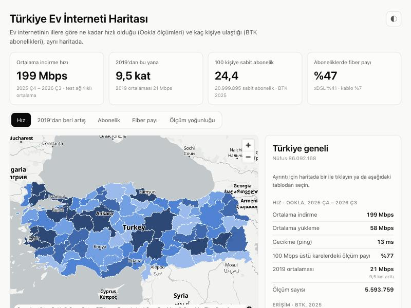

# Türkiye Ev İnterneti Haritası

> Bu klasör NetAtlas TR'nin ilk prototipidir; asıl proje deponun kökünde geliştiriliyor ([yol haritası](../docs/YOL-HARITASI.md)). Aşağıdaki komutlar bu klasörün içinden çalıştırılır.

Türkiye'de ev internetinin illere göre **ne kadar hızlı** olduğunu (Ookla'nın açık Speedtest verisi) ve **kaç kişiye ulaştığını** (BTK'nın il bazlı abonelik istatistikleri) aynı haritada gösteren bir prototip.



## Neler var

- **İl haritası**, beş gösterge arasında geçişle: ortalama indirme hızı, 2019'dan bu yana hız artışı, 100 kişiye sabit abonelik, fiber payı, ölçüm yoğunluğu.
- **Yakınlaşınca ~2,4 km'lik hız hücreleri**: Ookla'nın ~610 m'lik karelerinden türetilmiş, en az 10 ölçüm olan hücreler.
- **İl kartı**: hız, gecikme, 2019 karşılaştırması, abonelik ve fiber payı, 2020–2025 eğilimleri ve **güvenilirlik** etiketi (ölçüm sayısına göre).
- **Hız ve erişim grafiği**: her il bir nokta; hızlı ama yaygın olmayan illeri bir bakışta gösterir.
- **Tablo**: 81 ilin tüm değerleri, sıralanabilir. Haritanın erişilebilir karşılığı.
- Açık/koyu tema, telefon uyumu, Türkçe arayüz.

## Öne çıkanlar (2025 Ç4 – 2026 Ç3 ölçümleri, BTK 2025)

- Türkiye geneli ortalama indirme hızı **~199 Mbps**. 2019'da **~21 Mbps** idi (**~9,5 kat**).
- En hızlı il İstanbul (**~250 Mbps**), en yavaşı Kilis (**~81 Mbps**). Güneydoğudaki illerin çoğu listenin alt sıralarında (Diyarbakır hariç).
- Asıl fark erişimde: 100 kişiye sabit abonelik İstanbul'da **31,7**, Ağrı'da **7,4**.
- Fiber payı Van'da **%72**, Denizli'de **%21**.

## Veri kaynakları

| Veri | Kaynak | Lisans |
|---|---|---|
| Sabit internet hız ölçümleri | [Ookla Open Data](https://github.com/teamookla/ookla-open-data) (Speedtest uygulamalarından, Wi-Fi/kablolu, GPS konumlu testler; ~610 m'lik kareler, çeyreklik) | CC BY-NC-SA 4.0 |
| İl bazlı abonelik, fiber, kapsama | BTK, *Elektronik Haberleşme Sektörüne İlişkin İl Bazlı Yıllık İstatistik Bülteni 2026* (2020–2025), [Yıllık İl İstatistikleri](https://www.btk.gov.tr/yillik-il-istatistikleri) | Açık lisans yok (© BTK, tüm hakları saklı); kaynak gösterilerek kullanıldı, ticari kullanım için izin gerekir |
| İl sınırları | [geoBoundaries](https://www.geoboundaries.org/) (OpenStreetMap tabanlı) | CC BY-SA / ODbL |
| Altlık harita | [OpenFreeMap](https://openfreemap.org/), © OpenMapTiles, © OpenStreetMap katkıcıları | |
| Harita kütüphanesi | [MapLibre GL JS](https://maplibre.org/) | BSD-3 |

Ookla atfı: *Speedtest® by Ookla® Global Fixed and Mobile Network Performance Maps. Based on analysis by Ookla of Speedtest Intelligence® data for 2019 Q1–Q4 and 2025 Q4–2026 Q3. Provided by Ookla and accessed 19 October 2026. Ookla trademarks used under license and reprinted with permission.*

Ookla verisi ticari olmayan kullanım ve aynı lisansla paylaşım şartı taşıdığından, `web/data/` ve `data/processed/` altındaki türetilmiş veriler de **CC BY-NC-SA 4.0** ile paylaşılır.

## Yöntem

- **Dört çeyrek birleştirildi.** Tek çeyrekte doğudaki bazı illerde yalnızca birkaç yüz test var. Her kare için testler toplanıp ortalamalar test sayısıyla ağırlıklandırıldı. Karşılaştırma dönemi 2019'un dört çeyreği.
- **Karenin hangi ile ait olduğu**, karenin alanının en az %20'si Türkiye karasındaysa ve en çok hangi ilin içindeyse ona göre belirlendi. Bunun için tam çözünürlüklü sınırlar kullanıldı. Böylece merkezi denize düşen kıyı kareleri dahil oluyor, sınırın öbür yanındaki yerleşimler (ör. Kamışlı, Tel Abyad) dışarıda kalıyor.
- **İl değeri**, ildeki tüm testlerin test ağırlıklı ortalaması.
- **Güvenilirlik**: dört çeyrekte 10.000 testin üstü yüksek, 2.000–10.000 orta, altı düşük (81 ilden 54'ü yüksek, 23'ü orta, 4'ü düşük).
- **Erişim**: sabit genişbant aboneliği ÷ nüfus × 100. Fiber payı = fiber ÷ tüm sabit abonelikler.
- **Kontrol**: PDF'ten çıkarılan il toplamları BTK'nın ulusal toplamıyla karşılaştırılır. Nüfus, fiber, xDSL ve fiber kablo uzunluğu birebir tutuyor. Sabit abonelikte %0,1'lik fark, BTK'nın illere dağıtamadığı ISDN ve uydu aboneliklerinden geliyor.

## Sınırlamalar

- **Ortalama, tipik kullanıcıdan yüksek çıkar.** Ookla kare başına yalnızca ortalama yayınlıyor. Türkiye'de hızlar iki gruba ayrılıyor: çok sayıda VDSL kullanıcısı ve gigabit fiber kullanıcıları. Speedtest'in kendi yayınladığı medyan 2026'da ~84 Mbps civarında. Harita iller arası karşılaştırma için okunmalı.
- **Ölçülen hız, altyapı değildir.** Düşük ortalama, fiber olmadığı anlamına gelmez; insanlar düşük paket almış olabilir.
- **Ölçümler yalnızca Speedtest uygulamasından** ve konum izni veren kullanıcılardan geliyor. Turistik illerde ziyaretçilerin testleri de sayılıyor; Muğla'nın ölçüm yoğunluğunun en yüksek çıkması bundan.
- **Abonelik, hane değildir.** Bir hanede genelde tek abonelik vardır ve iş yeri abonelikleri de sayıya dahildir; gerçek hane oranı için TÜİK hane sayıları gerekir.
- BTK verisi yalnızca il düzeyinde. İlçe ve mahalle düzeyinde yalnızca Ookla hızları var.

## Çalıştırma

Gerekenler: [uv](https://docs.astral.sh/uv/) ve `pdftotext` (poppler: macOS'ta `brew install poppler`, Debian/Ubuntu'da `apt install poppler-utils`).

```bash
# 1. Ookla: Türkiye'ye düşen kareleri indir (dosyanın tamamı değil, yalnızca ilgili kısım)
uv run python -m pipeline.ookla fixed 2025-4 2026-1 2026-2 2026-3 2019-1 2019-2 2019-3 2019-4

# 2. BTK bültenini tabloya çevir -> data/processed/btk_iller.csv
uv run python -m pipeline.btk

# 3. İl sınırlarını indir
uv run python -m pipeline.boundaries

# 4. Hepsini birleştir -> web/data/*.json, data/processed/iller_ozet.csv
uv run python -m pipeline.build

# 5. Siteyi aç: http://localhost:8765
python3 -m http.server 8765 --directory web
```

`web/` klasörü statik bir sitedir; GitHub Pages gibi bir yerde doğrudan yayınlanabilir.

## Klasörler

```
pipeline/   veri hattı (Ookla, BTK, sınırlar, birleştirme)
data/raw/   indirilen ham dosyalar (git'e girmez)
data/processed/  btk_iller.csv, iller_ozet.csv
web/        harita sayfası (index.html, app.js, style.css, data/)
```

## Sonraki adımlar

- İlçe sınırlarıyla ilçe bazında hız haritası
- 2019–2026 arası tüm çeyreklerle zaman kaydırıcı
- Mobil veriyle 5G öncesi/sonrası karşılaştırması (5G Nisan 2026'da açıldı)
- M-Lab verisiyle internet sağlayıcısı karşılaştırması
- TÜİK hane sayılarıyla gerçek hane erişim oranı
- GitHub Actions ile her çeyrek otomatik güncelleme
